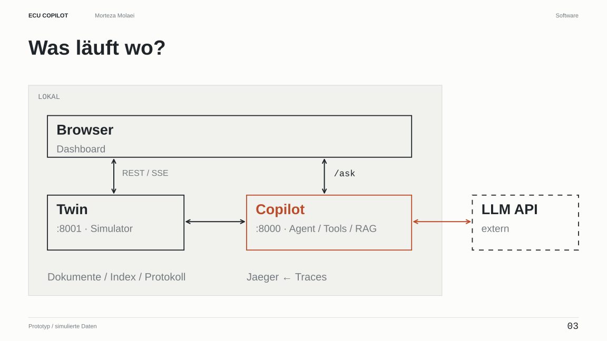

# ECU Copilot

An investigation assistant for test engineers on an electronics end-of-line (EOL) line:
**one agent + engineering tools + RAG + evidence checks**, with tracing, token-based cost estimates and evals.
The prototype runs against a stateful **simulator of three parallel EOL test stations** for door control units
(DCU-A1 / DCU-B2). Test data and engineering documents are synthetic; no physical production line is connected.

**Presentation (German):** [slide PDF](design/presentation/ECU-Copilot-Praesentation.pdf) ·
[diagrams and speaker notes](design/presentation/README.md) ·
[implemented architecture and data flow](design/ARCHITECTURE_CURRENT.md).

## Problem and intended benefit

1. **What is the problem?** A failed EOL test does not identify its cause. The engineer needs to distinguish
   a unit defect, invalid test conditions, an unreliable measurement and concurrent causes, using test data
   and the applicable technical specification.
2. **Why does it matter?** Gathering and interpreting that context can take time. A wrong conclusion can
   cause unnecessary re-tests or leave a defect unresolved. Invalid test conditions do not establish that
   a unit is healthy.
3. **What is the solution?** The copilot retrieves data and documents, calls engineering tools and prepares
   group assessments with evidence and proposed counter-checks. The verifier marks unsupported or
   conflicting assessments. The engineer reviews the report and records a next step.
4. **Why this approach?** Explicit calculations and criteria belong in tools; the model selects tools and
   explains their results. The rule-engine baseline tests whether adding an agent helps. Matching an
   evidence reference does not by itself prove a diagnosis.

**Economic hypothesis:** reduce investigation preparation and documentation time while maintaining decision
quality. This is a target workflow, not an observed process at any specific company. Production accuracy and engineer time
savings have not been established. A future pilot should compare the existing workflow with copilot-assisted
work on historical cases, measuring time through a defensible next step, including review, and the quality
of that step. Integration, operation and maintenance costs also count. See the [concept (German)](design/CONCEPT.md#1-problem-lösung-und-erwarteter-nutzen).

## Architecture



The browser reads live results from the Twin and sends investigation requests to the Copilot API.
The Copilot runs local tools, document retrieval and evidence checks, and calls the selected external model.
Only the benchmark freezes one shared data snapshot per scenario; ordinary live tool calls query the evolving Twin.

| Concern | Choice | Why |
|---|---|---|
| Agent loop | Anthropic SDK tool runner or explicit OpenAI loop | One agent; provider/model are configurable. The benchmark archive records the configuration actually used. |
| Engineering | Four deterministic analysis tools plus five base tools | Validity, change detection, clustering and signal descriptors complement statistics, individual results, documents, BOM lookup and 8D drafting. |
| RAG | Local BM25; optional fastembed + embedded Chroma; rank fusion | Exact identifiers and semantic retrieval. The selected context, including tool outputs, is sent to the model provider. |
| Evidence checks | Reference matching; limited support checks | Provenance is distinct from diagnosis correctness; document support uses a keyword heuristic. |
| Twin | FastAPI, in-memory, seeded RNG | Controlled synthetic cases. Real-system integration and validation remain future work. |
| Observability | OpenTelemetry → Jaeger; per-question JSONL metrics | Trace investigation steps, latency, token usage and calculated cost. |
| Quality | Offline pytest, golden-set evals, scenario benchmark | Shared scenario snapshots and archived reports; exploratory cases are reported separately. |

## Quick start

```bash
cp .env.example .env            # OPENAI_API_KEY (all benchmark results below) or ANTHROPIC_API_KEY; set LLM_PROVIDER
docker compose up --build       # first start downloads the embedding model (~250 MB) into a volume
```

- Dashboard: http://localhost:8000 · twin API docs: http://localhost:8001/docs · traces: http://localhost:16686

Local development without Docker:

```bash
uv sync
uv run python -m ecu_copilot.rag.ingest                      # build the document index
uv run uvicorn ecu_copilot.twin.api:app --port 8001          # terminal 1
uv run uvicorn ecu_copilot.copilot.api:app --port 8000       # terminal 2 (needs ANTHROPIC_API_KEY)
```

Try it: click **Temperaturdrift St. 2**, wait a minute, ask
*"Warum fällt Variante B an Station 2 seit 10 Minuten überdurchschnittlich oft durch?"*

### First investigation in five minutes

Without an API key the stack still starts: the dashboard shows the three stations and their live
tests, faults can be injected, and the offline tests run. Only `/ask` needs a model key.

1. Open the dashboard at http://localhost:8000 and let the simulator run for a minute.
2. In the panel *Demo-Störung · Betreiberwissen* inject a temperature drift on station 2 (default +10 °C).
   The agent has no tool for this panel; it has to infer the fault from measurements.
3. Wait two to three minutes. Variant B on station 2 starts failing with E-204 (quiescent current),
   variant A barely, because B sits closer to its limit.
4. Ask, for example: *Why does variant B on station 2 fail more often since a few minutes? Unit defect
   or test conditions?* The tool calls appear while the agent works (one to three minutes with gpt-5).
5. Read the report: one assessment per group (test validity separate from unit-defect indication),
   consistency marks if any, evidence with provenance ✓/✗, and a proposed counter-check. Expected for
   this fault: *test invalid (temperature), unit not assessable, cause station temperature*. An invalid
   test leaves the unit condition open; it does not clear the unit.
6. Open the same question as a trace in Jaeger (http://localhost:16686): one span per model call and
   per tool call. Reset the faults in the dashboard afterwards.

A second scenario: reset, inject a bad connector lot, ask about the E-120 failures on variant B. Here
the agent has to find a real defect concentrated in one lot rather than an environmental cause.

## Tests and evals

```bash
uv run ruff check . && uv run ruff format --check .
uv run pytest                        # no API key, no model download (RAG_MODE=bm25 in CI)
# If a ROS 2 workspace is sourced in your shell, its pytest plugins break collection: PYTHONPATH= uv run pytest
uv run python evals/run.py           # golden set against the live agent; needs twin running + API key
uv run python evals/run.py --only live-drift-pseudo-failure --no-judge
```

The eval has three layers per case - expected tools called (deterministic), key facts present
(deterministic), rubric satisfied (LLM-as-judge). It exits non-zero below `EVAL_MIN_PASS` (0.8),
which is the gate in the manual `eval` job of `.gitlab-ci.yml` / GitHub Actions.

## V2: deterministic evidence, verified, benchmarked

The literature on LLM agents for root-cause analysis is consistent on one point: the most frequent
failure is a coherent story the data does not support, and prompting does not fix it - checking does
(see `design/RESEARCH.md`). V2 therefore adds three things in front of and behind the model:

1. **Engineering layer** (`src/ecu_copilot/engineering/`, no LLM): `check_validity` (which FAIL verdicts
   are INVALID per the machine-readable spec `docs/spec/TS-DCU-EOL.json`, consistency-tested against the
   markdown), `detect_change` (change-point scan: onset, levels, z), `cluster_failures` (lot / firmware /
   station concentration with exposure-aware lift, rate ratio and z), `describe_signal` (descriptors,
   Iq-T1 relation incl. the sensor-fault signature). The agent is told to call these before it claims
   anything about validity, trends or lots - it integrates and explains, it does not compute.
2. **Report schema V2**: `assessments` per affected group with *test validity* separate from *defect
   indication* (an invalid test says nothing about the unit; concurrent causes are two entries),
   hypotheses with a *discriminating* test, evidence items with a structured `ref` (tool call, field,
   station, variant, window, value / doc, revision, section).
3. **Verification** (`copilot/verify.py`, no LLM): *provenance* - does the ref resolve to this run's tool
   output for exactly that scope and value, does the cited document / section / revision exist; and
   *support* - spec comparisons for live refs, keyword overlap for documents (a heuristic, named as such).
   The UI shows both marks per evidence item.

`AGENT_PROFILE=v1|v2` keeps the original agent available for comparison. The **benchmark**
(`evals/bench.py`) runs scenarios with known truth (`evals/scenarios/`) against four systems - **B0** a
fair rule engine on the same engineering tools, **B1** single-call RAG without tools, **V1**, **V2** -
with repeats, a solvability check per scenario, and the metrics from `design/CONCEPT.md` §5. Results are
appended to `design/RESULTS.md`.

```bash
uv run python evals/bench.py --scenarios S01,S08 --systems b0,b1,v1,v2 --repeats 3
```

## The investigation workspace

The agent's final message is a structured **investigation report** (JSON schema enforced on both
providers): finding type, hypotheses with *evidence strength* (strong / moderate / weak / rejected -
never a made-up confidence number), evidence items with source (`live` tool data or `document`
citation), the proposed next test, and the affected components. The dashboard renders it as:

- a **signal strip** (I_q and T1 over time, limit line, invalid-temperature band, fail markers, cursor),
- a **schematic** of the door drive with the fault path per failure code and clickable parts (BOM / PCN),
- the **agent's activity** (every tool call with arguments, duration and what came back),
- hypotheses, evidence table, next test - and **approval by the engineer**, logged with the trace id
  (`POST /decisions`).

All test data comes from the digital twin and the documents are synthetic; the UI says so.

## How the demo scenario works

1. The station firmware checks limits from the test specification, but **not** the spec's environmental
   validity rule (TS-DCU-EOL §4.2: results outside 18-32 °C are INVALID, not FAIL). That gap exists in the
   twin on purpose - it mirrors a real Rev. D note in the spec.
2. Quiescent current rises with temperature (~3 %/K). Variant B sits closer to its limit (330 µA typical
   vs 450 µA limit) than variant A (240 vs 350), so drift hits B first.
3. The agent sees E-204 rising on station 2 / variant B, reads the mean temperature (>32 °C), finds §4.2
   and FMEA item 11, and concludes *test invalid: unit condition still open; correct the station and re-test under valid conditions*. Invalid test conditions never justify a release - a unit can be defective in addition.

Two more faults are built in: hall noise (E-310 above 45 dB(A), spec §6.1) and a bad connector lot
(E-120 clustered on lot L2439-07, FMEA item 7) - a *real* failure the agent must not explain away.

## Monitoring

Per question the Copilot records latency, model calls, tools, tokens, calculated cost and errors
(`data/metrics.jsonl`, summarised at `/metrics`). The same figures are exposed for Prometheus at
`/metrics/prometheus` (counters, a latency histogram, Twin and index gauges; no client library).
Traces per model call and tool call stay in Jaeger. An optional overlay adds Prometheus and Grafana
with a provisioned dashboard:

```bash
docker compose -f docker-compose.yml -f docker-compose.monitoring.yml up -d
# Prometheus http://localhost:9090 · Grafana http://localhost:3000 (anonymous viewer)
# ports taken by another stack: PROMETHEUS_PORT=9091 GRAFANA_PORT=3001 docker compose ... up -d
```

The dashboard answers operational questions over time: how long answers take (mean and rolling p95),
how many fail, how tokens and calculated cost develop, which tools are used, and whether Twin and
document index are up. It says nothing about whether a diagnosis is correct; that remains the
benchmark's job.

## CI, release and deploy

Every push runs `.github/workflows/ci.yml`: `ruff check`, `ruff format --check`, the offline tests
(`RAG_MODE=bm25`, mocked model clients), then a Docker smoke test that builds the image, starts Twin and
Copilot with Compose and checks `/health` (Twin reachable, index ready). The paid `eval` job runs only on
manual dispatch. Green CI proves that the software builds and its deterministic parts behave as tested;
it does not prove a correct diagnosis (see the S05 case in the results).

A Git tag `v*` runs `.github/workflows/release.yml`: it builds one versioned image (Twin and Copilot share
it), smoke-tests exactly that image and publishes it to GHCR as `ghcr.io/moti1313/ecu-copilot:<tag>`.
Deployment is a deliberate step on the target host:

```bash
docker login ghcr.io                     # once; the package is private like the repository
export ECU_VERSION=v0.2.0
docker compose -f docker-compose.yml -f docker-compose.release.yml pull
docker compose -f docker-compose.yml -f docker-compose.release.yml up -d --no-build
curl -s localhost:8000/health
```

Rollback: set `ECU_VERSION` to the previous tag and repeat pull and up; the data volume is kept.
A Kubernetes target would reuse the same image with a Deployment per service, a Secret for the key and a
readiness probe on `/health`; that is not part of this repository.

## Production notes (what would change at a real site)

- **Data sources:** the twin becomes an adapter to the MES / test-station database; the nine tools keep their
  schema. Events would come from Kafka instead of SSE.
- **Deployment:** the compose file maps 1:1 to two Deployments, a Service each, a Secret for the key and an
  OTLP collector; the embedding model lives in an image layer or a PVC.
- **Model access:** `AnthropicBedrockMantle` swaps in for `Anthropic()` on AWS; nothing else changes.
- **Guardrails:** the citation check is a minimum. Next: a topic classifier on input, schema-validated
  answers for the 8D path, and sampling of answers into the eval set from the metrics log.
- **Prompt caching:** the system prompt is cached (`cache_control`), the dashboard shows the cache hit ratio.

## Repository layout

```
src/ecu_copilot/
  config.py            environment-driven settings, pricing table
  twin/                models.py (API contract) · simulator.py (the generator) · api.py (FastAPI)
  rag/                 chunking.py · index.py (Chroma + BM25, RRF) · ingest.py (CLI)
  copilot/             tools.py · agent.py · api.py · telemetry.py · metrics.py · static/index.html
docs/                  six engineering documents (synthetic, consistent limits) + BOM-DCU.json
evals/                 bench.py (scenario benchmark) · baselines.py (B0 rule engine, B1 single-call RAG) · rescore.py · scenarios/ · golden.json · run.py
tests/                 67 tests, fake LLM client, no API key
examples/hello_agent.py   the agent loop written by hand (day-1 version)
```

## Benchmark results (run 4, 2026-10-17) - the honest version

Pre-registered run (`design/CONCEPT.md` §10): four regular scenarios with known truth (temperature drift,
no fault, faulty T1 sensor, drift + bad connector lot), frozen twin snapshot per scenario, 3 repeats,
systems B0 (rule engine on the same engineering tools), B1 (single-call RAG), V1S (V1 tools + V2 schema),
V2 (engineering tools + verified evidence). Model gpt-5. Details: `design/RESULTS.md`, `design/RUN4_REVIEW.md`.

| System | Exact assessments (regular, 12 runs) | Notes |
|---|---|---|
| B0 rule engine | **12/12** | 0 s, 0 $ |
| V2 agent | 8/12 | S01 3/3, S04 3/3 (abstained correctly, no detector false alarm), **S05 0/3** (named the sensor fault but also fixed "overtemperature" as a cause - a contradictory final assessment), S08 2/3 |
| V1S | 5/12 | the report format alone explains most of V1 -> V2 |
| B1 chatbot | 0/12 | |

What this shows: for known failure patterns the rule engine is better than the agent. The agent produces
traceable evidence (run 4, V2: 155/165 live references and 47/47 document references automatically
resolvable - this confirms the references, not the diagnosis) and proposes counter-checks; its additional
practical value for cases outside the rule set remains to be measured. Next improvement: the verifier flags
contradictory or unsupported final assessments (it does not substitute a cause).
