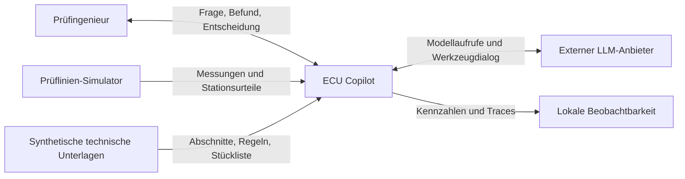
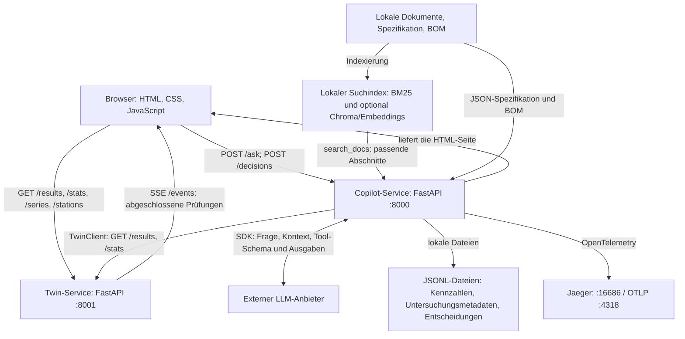
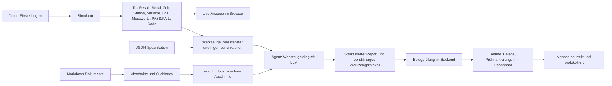
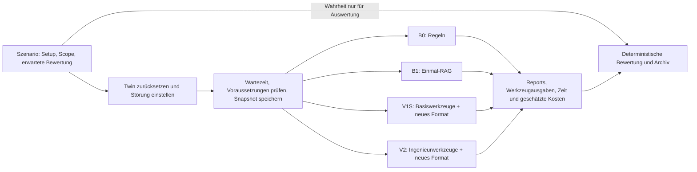

# ECU Copilot – umgesetzte Architektur

Stand: **21.10.2026**. Am Code abgeglichen; keine Beschreibung eines bereits produktiv eingesetzten Systems.

Technische Diagramme: [presentation/README.md](presentation/README.md). Umfang und offene Erweiterungen: [CONCEPT.md](CONCEPT.md). Gemessene Ergebnisse: [RESULTS.md](RESULTS.md).

## 1. Das System in einem Satz

Ein Prüfingenieur untersucht simulierte End-of-Line-Prüfungen von Türsteuergeräten. Ein einzelner KI-Agent verbindet Werkzeugausgaben und technische Dokumentabschnitte zu einem strukturierten Befund mit Belegen und einem vorgeschlagenen nächsten Prüfschritt. Der Mensch beurteilt das Ergebnis und protokolliert seine Entscheidung.

**Datenstatus:** Die Prüfdaten, Bauteilunterlagen und Prüfregeln im Repository sind synthetisch. Der als „Digital Twin“ bezeichnete Dienst ist hier ein zustandsbehafteter Prüflinien-Simulator. Eine Synchronisation mit einer realen Anlage und eine Validierung an Produktionsdaten sind nicht umgesetzt. Diese Einordnung folgt dem Unterschied zwischen unserem Code und der Darstellung physisch angebundener Zwillinge bei [NIST AMS 400-2, §2.1](https://nvlpubs.nist.gov/nistpubs/ams/NIST.AMS.400-2.pdf).

## 2. Systemkontext

Die Darstellung trennt fachlichen Kontext und technische Laufzeit nach der Idee des [C4-Modells](https://c4model.com/diagrams). Die folgenden Mermaid-Diagramme sind eigene vereinfachte Darstellungen, keine formale C4-Zertifizierung.



Der Ingenieur und die Demo-Steuerung können Störungen des Simulators sehen und verändern. Der Diagnose-Agent erhält dafür **kein Werkzeug**. Das ist eine Trennung des Analysekontexts durch das Werkzeugangebot, keine Zugriffssicherung einer Produktionsanlage.

## 3. Technische Laufzeit



| Laufzeit / Modul | Aufgabe | Codebeleg |
|---|---|---|
| Browser | Produktionskarten, Prüfliste, Prüfung öffnen, Untersuchung, Entscheidung | `src/ecu_copilot/copilot/static/index.html` |
| Copilot-API | Startet Untersuchung; vergibt `investigation_id`; nimmt Entscheidungen entgegen | `copilot/api.py`: `ask`, `_store_investigation`, `add_decision` |
| Agentenadapter | Ein Agent mit iterativer Werkzeugnutzung; wahlweise Anthropic oder OpenAI | `copilot/agent.py`: `Copilot`, `OpenAICopilot`, `make_copilot` |
| Werkzeugschicht | Begrenzt Datenzugriffe; lädt Messfenster, Dokumente und Stückliste | `copilot/tools.py`: `TOOLS_V1`, `TOOLS_V2`, `_window` |
| Ingenieurfunktionen | Prüfgültigkeit, Änderungserkennung, Fehlerkonzentration, Signalbeschreibung | `engineering/validity.py`, `change.py`, `cluster.py`, `describe.py` |
| RAG | Markdown-Abschnitte mit Metadaten; BM25; optional Vektorsuche und RRF | `rag/chunking.py`, `rag/index.py` |
| Belegprüfung | Referenzen gegen Werkzeugausgaben und Dokumentindex; begrenzte Stützungsprüfung | `copilot/verify.py`: `verify_report` |
| Konsistenzprüfung | K0–K4 markieren ausgewählte unbelegte oder konkurrierende Bewertungen; keine automatische Korrektur | `copilot/consistency.py` |
| Monitoring | Persistierte Kennzahlen, Prometheus-Exposition und optionales Grafana-Dashboard | `copilot/metrics.py`, `monitoring/`, `docker-compose.monitoring.yml` |
| Twin | Drei parallele Stationen; Generator, Fehlerregeln, Ergebnis-Puffer, REST und SSE | `twin/models.py`, `twin/simulator.py`, `twin/api.py` |
| Benchmark | Szenarioaufbau, Snapshot, Systemvergleich, Metriken und Archiv | `evals/bench.py`, `evals/baselines.py` |

`copilot/`, `engineering/`, `rag/` und Chroma sind **keine separaten Microservices**. Sie laufen als Python-Module bzw. eingebettete Bibliothek im Copilot-Prozess. Docker Compose startet drei Dienste: Twin, Copilot und Jaeger. Der Browser läuft außerhalb dieser Dienste.

Das optionale Monitoring-Overlay ergänzt Prometheus und Grafana. Prometheus liest `/metrics/prometheus` alle 15 Sekunden; Grafana stellt die gespeicherten Kennzahlen dar. Das Dashboard zeigt unter anderem die Erreichbarkeit des Copilot-Ziels, den zuletzt geprüften Twin-Zustand, die Indexbereitschaft, Token, geschätzte Kosten und ein aus Histogramm-Buckets geschätztes p95. Diese Kennzahlen messen den Betrieb, keine diagnostische Richtigkeit. Die HTTP-Antwort von `/health` allein ist kein vollständiger Readiness-Nachweis; seine Abhängigkeitsfelder müssen ausgewertet werden.

Der Suchindex und Embeddings werden lokal verarbeitet. An den gewählten LLM-Anbieter gehen die Frage, ausgewählte Dokumenttexte, Werkzeugbeschreibungen und während des Dialogs die verwendeten Werkzeugausgaben. „Alles bleibt lokal“ wäre daher falsch.

## 4. Datenfluss: von der Einheit zum Befund



1. `Simulator.tick()` erzeugt eine **abgeschlossene** Prüfung an einer Station. Station 1 prüft A, Station 2 A/B, Station 3 B; ein Gerät wandert in diesem Modell nicht durch alle drei Stationen.
2. Der Stationscode entscheidet anhand von Grenzwerten und der ersten fehlgeschlagenen Prüfstufe. Die zusätzliche Umwelt-Gültigkeitsregel wird absichtlich erst in der Ingenieurschicht ausgewertet.
3. Der Browser liest Ergebnisse direkt vom Twin. Die angezeigte Prüfreihenfolge wird aus Ergebnis und Spezifikation rekonstruiert; es gibt keine gemessenen Live-Zeiten einzelner Prüfschritte.
4. Für eine Untersuchung stellt der Agent Werkzeuganfragen. V2 ergänzt die fünf Basiswerkzeuge um vier Ingenieurwerkzeuge. Es gibt weiterhin direkten Zugriff auf begrenzte Einzelergebnislisten über `get_recent_results`; „nur vorverarbeitete Evidenz erreicht das Modell“ ist deshalb ein Ziel, keine vollständig erzwungene Eigenschaft.
5. Der Agent formuliert gruppenbezogene Bewertungen (`assessments`), Hypothesen, Referenzen und einen nächsten Testvorschlag.
6. V2 prüft Belegreferenzen nach dem Modellaufruf. Fehler werden markiert; es gibt keinen generellen automatischen Reparatur- oder Ablehnungszyklus.
7. Die API liefert Report, Prüfzusammenfassung, Werkzeugmetadaten und `investigation_id`. Vollständige Werkzeugausgaben bleiben aus dieser Browserantwort entfernt. Der Benchmark archiviert sie gesondert.

**Live-Betrieb und Benchmark unterscheiden sich:** Bei einer Live-Untersuchung wird der Twin je Werkzeugaufruf abgefragt und kann sich inzwischen weiterentwickeln. Ein angezeigter abgeschlossener Report bleibt ein historischer Untersuchungsstand. Eine atomare Dateneinfrierung zum Klickzeitpunkt bietet `/ask` derzeit nicht. Im Benchmark ersetzt `SnapshotTwin` dagegen den Live-Client: alle Systeme und Wiederholungen eines Szenarios sehen denselben gespeicherten Datenstand und dieselbe Bezugszeit.

## 5. Ablauf einer Untersuchung

```mermaid
sequenceDiagram
    actor E as Prüfingenieur
    participant B as Dashboard
    participant C as Copilot /ask
    participant M as LLM-Anbieter
    participant W as Werkzeuge und Daten
    participant V as Belegprüfung
    E->>B: Station/Prüfung wählen und Frage starten
    B->>C: POST /ask mit Frage
    loop Bis Antwort oder Abbruchbedingung
        C->>M: Kontext und Werkzeugangebot
        M-->>C: Gewünschter Werkzeugaufruf
        C->>W: Python-Werkzeug ausführen
        W-->>C: JSON-Ausgabe / Dokumentabschnitt
        C->>M: Werkzeugergebnis zurückgeben
    end
    M-->>C: Strukturierter Report
    C->>V: Report + vollständige Werkzeugausgaben + Index
    V-->>C: Herkunft, begrenzte Stützungsprüfung, Hinweise
    Note over C: Untersuchungsmetadaten mit ID speichern
    C-->>B: Report, Prüfmarkierungen, investigation_id
    E->>B: Nächsten Schritt beurteilen
    B->>C: POST /decisions mit investigation_id
    Note over C: Nur Protokoll; keine Sperrung / Wiederholungsprüfung
```

Die konkrete Werkzeugauswahl ist dynamisch. Die Sequenz beschreibt den möglichen Dialog, keine garantierte feste Liste von Aufrufen. Die normale API verarbeitet eine Frage pro Anfrage; der Browser sendet keinen fortlaufenden Chat-Verlauf.

## 6. Belege, Diagnosen und Entscheidungen

| Ebene | Was sie aussagt | Was daraus nicht folgt |
|---|---|---|
| Betreiberwissen | Welche Störung im Versuch eingestellt wurde | Der Agent habe sie selbst aus Daten bewiesen |
| Beobachtung | Ein simuliertes Ergebnis / ein berechnetes Merkmal liegt vor | Die vermutete Ursache sei eindeutig identifiziert |
| Herkunftsprüfung | Referenz und Wert bzw. Dokumentabschnitt sind nachvollziehbar | Der gesamte Satz oder die Diagnose sei richtig |
| Stützungsprüfung | Einige einfache Grenzwertvergleiche passen; Dokumentbegriffe überlappen | Vollständige semantische oder kausale Verifikation |
| Hypothese | Das Modell schlägt eine Erklärung und einen Prüfschritt vor | Die Ursache sei durch einen unabhängigen Test bestätigt |
| Entscheidung | Ein Mensch hat einen Vorschlag mit Untersuchungs-ID protokolliert | Ein Gerät sei gesperrt oder tatsächlich erneut geprüft |

Die Unterscheidung von Datenherkunft und inhaltlicher Bewertung passt zum allgemeinen Provenienzbegriff von [W3C PROV](https://www.w3.org/TR/prov-overview/). Der Prototyp implementiert ein eigenes Referenzformat; er implementiert **keinen W3C-PROV-Standardexport**.

Eine nach Spezifikation ungültige Prüfung erlaubt keine belastbare Bauteilbewertung. Ein zusätzlicher Defekt bleibt möglich. Ein gemeldeter Sensorwert ist selbst eine potenziell fehlerhafte Messung.

## 7. Versuchsaufbau und Aussagegrenze



- Lauf 4 verwendete vier reguläre Szenarien plus das getrennte explorative S08w, mit drei Wiederholungen je System. Die Ergebnisse des konkreten Laufs stehen ausschließlich im zugehörigen Archiv und in `RESULTS.md`.
- Setup und erwartete Diagnose sind Auswertungswissen. Der Agent erhält die Frage und sein Werkzeugangebot; B0 bekommt zusätzlich den expliziten Untersuchungs-Scope (Station/Variante).
- Nicht erfüllte Voraussetzungen und explorative Fälle bleiben sichtbar und werden separat ausgewiesen. S04-Fehlalarme des Detektors sind Ergebnisse, kein Ausschlussgrund.
- V1S und V2 teilen das Berichtsformat; damit ist dieser Vergleich für den Werkzeugeffekt aussagekräftiger als B1 gegen V2. B1 verwendet das ältere Schema. B0 hat Regeln für die bekannten Muster.
- Drei Wiederholungen auf demselben Szenario-Snapshot messen Antwortschwankungen. Sie sind **keine drei unabhängigen Produktionsdatensätze**.
- Kosten sind aus Token-Nutzung und konfigurierten Preisen berechnet. Die bisherige Evaluation misst keine nachgewiesene Zeitersparnis für Prüfingenieure.

## 8. Umgesetzt und später

| Fähigkeit | Stand |
|---|---|
| Live-Prüfliste, Einzelbefund, Dokumentabschnitte und Untersuchung | umgesetzt |
| Vier zusätzliche Ingenieurwerkzeuge und V2-Belegprüfung | umgesetzt |
| Temperaturdrift, Lärm, fehlerhaftes Los, Sensor-Offset | umgesetzt |
| Untersuchungsmetadaten und Entscheidungen als JSONL | umgesetzt; kein vollständiges Fallakten-System |
| Wiederholungsprüfung derselben Einheit mit persistentem Defektzustand | geplant; kein `/retest`-Endpunkt |
| `simulate_retest` und automatische Gegenprüfung von Vorhersagen | geplant |
| Firmwarewechsel und Fixture-Defekt als injizierbare Störungen | geplant |
| Vollständige Auswahl aktueller gegenüber überholten Dokumentrevisionen | geplant; vorhandene Metadaten-/Belegprüfung ist kein vollständiger Revisionsworkflow |
| Optionaler Router / Jev | separates Schattenexperiment ausgeführt; kein Einbau in den Antwortpfad |
| Physisch angebundener Twin und Nachweis an realen Produktionsdaten | spätere Validierung |

## 9. Weitere Validierung

Offen sind eine feste Datenbasis pro Live-Untersuchung und eine erneute Prüfung derselben identifizierten Einheit. Eine fachliche Bewertung an realen anonymisierten Prüfdaten und ein Vergleich der Bearbeitungszeit mit Prüfingenieuren würden den praktischen Nutzen untersuchen. Die synthetischen Szenarien allein beantworten diese Fragen nicht.
